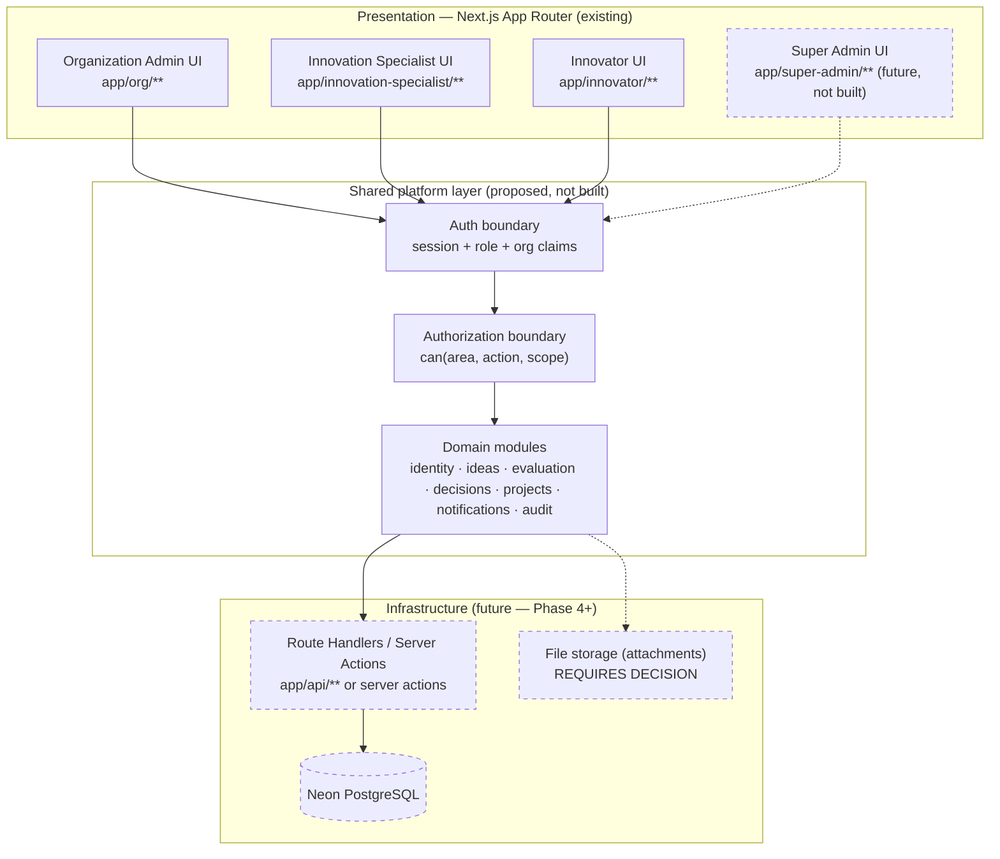
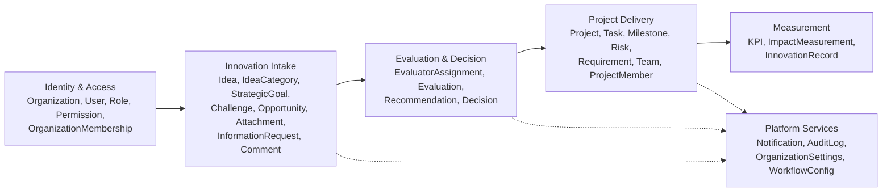
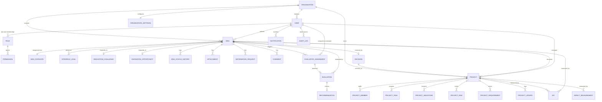

# PHASE 3 — ARCHITECTURE PROPOSAL
### منارة (Manarah) — Final Application Architecture Design

**Status:** Proposal only. Nothing in this document has been implemented. No Neon connection, no tables, no migrations, no auth changes were made while producing it.
**Scope:** Design the target architecture for Phases 4+ (Neon database, real auth, real permissions, Super Admin) based strictly on what exists in the merged codebase today.
**Rule followed throughout:** every claim below is traceable to a specific file in the repo. Anywhere the codebase doesn't already answer a question, it is marked **REQUIRES DECISION** rather than guessed.

---

## 0. The one finding that shapes everything else

The three interfaces do not share data today. They share a codebase and a build, but at runtime each one reads from its own independent, disconnected mock dataset:

| Interface | Data source | Type system |
|---|---|---|
| Organization Admin (`app/org/**`) | `lib/store.tsx` (React Context) + `lib/mock-data/seed.ts` | `lib/types.ts` — English enums (`SUBMITTED`, `UNDER_REVIEW`, …) |
| Innovation Specialist (`app/innovation-specialist/**`) | `lib/innovation-specialist/mock-data.ts`, read directly per page, no shared context | `lib/innovation-specialist/types.ts` — **Arabic string literals** (`"جديدة"`, `"قيد التقييم"`, …), mostly view-model shapes rather than raw entities |
| Innovator (`components/innovator-src/**`) | `components/innovator-src/services/mock/*` behind per-feature service interfaces (`ideaService`, `projectService`, …) | `components/innovator-src/features/*/types.ts` — English enums, different vocabulary again |

This was a deliberate, approved Phase 1 decision (`docs/MERGE_PLAN.md §3.4`: *"no single source of truth exists today in any of the three... unifying types now would be a large business-logic change, not a merge requirement"*) — it was correct for Phase 1. But it means, concretely: an idea submitted through the Innovator UI does not appear in the Organization Admin's idea queue, and a decision recorded by Organization Admin does not reach the Innovator's idea timeline. There is one real "منارة" idea-management process described three different ways.

**The purpose of Phase 4 (Neon) is therefore not "add a database under each screen" — it is to give these three views of one underlying process a single shared source of truth for the first time.** Everything in this proposal is organized around that.

---

## 1. Architecture diagram



Today, everything left of `Shared` exists; everything in `Shared` and `Infra` is mock/in-memory or absent. The Innovator module already has the closest thing to this shape in embryo — `authService` behind an interface, `apiClient.ts` explicitly reserved with the comment *"Phase 10 — no endpoints wired up yet"*. This proposal generalizes that pattern to the whole platform rather than inventing a new one.

---

## 2. Final folder structure (target — not applied in this phase)

```
manarah-platform/
├── app/                              # routing + composition ONLY — no business logic
│   ├── org/**                        # unchanged
│   ├── innovation-specialist/**      # unchanged
│   ├── innovator/**                  # unchanged
│   ├── super-admin/**                # future — reserved path, not created yet
│   └── api/**                        # future Route Handlers (Neon-backed), not created yet
│
├── modules/                          # NEW — one dir per business domain (see §6)
│   └── <domain>/
│       ├── entities.ts               # canonical types (today: split across lib/types.ts, lib/innovation-specialist/types.ts, innovator-src/features/*/types.ts)
│       ├── enums.ts                  # canonical status/priority vocab (today: 3 divergent vocabularies)
│       ├── repository.ts             # data access interface — mock impl now, Neon/Prisma impl later
│       ├── service.ts                # business rules, framework-agnostic
│       └── view-models/              # per-role shaping (e.g. Idea → IdeaListItem for Specialist)
│
├── components/
│   ├── ui/                           # today: Org Admin's kit lives here — becomes the eventual shared kit ONLY when visual unification is explicitly approved (not this phase)
│   ├── org-admin/{ui,layout}/        # namespaced — unchanged from today
│   ├── innovation-specialist/{ui,layout}/   # namespaced — unchanged from today
│   └── innovator/{ui,layout}/        # today: components/innovator-src/** — proposed rename for consistency, not required
│
├── lib/
│   ├── auth/                         # NEW (future) — shared session/RBAC contract, replaces 3 ad hoc approaches
│   ├── db/                           # NEW (future) — Neon client, Prisma schema/migrations
│   └── config/                       # NEW (future) — env, feature flags
│
├── docs/                             # unchanged — MERGE_PLAN.md, PHASE2_REPORT.md, integration guides, this file
└── prisma/ (or drizzle equivalent)   # future — schema.prisma, migrations/
```

This is additive: nothing under `app/` or the existing `components/*` namespaces moves in this phase. `modules/` is new and, when built in a later phase, becomes the place business logic and data access live, so that route files stay thin (routing + composition) and role UIs stop each owning a parallel copy of the same domain rules.

---

## 3. Application architecture and layer boundaries

Four layers, cutting across all three (soon four) interfaces:

1. **Presentation** — `app/**` route files, `*-client.tsx` components, role-specific `components/<role>/ui`. Owns layout, forms, visual identity. Should not contain business rules (a few currently do — see §16).
2. **Domain / application** — the proposed `modules/<domain>/service.ts` layer. Owns business rules: what transitions an idea can make, what a specialist may and may not do, how KPIs are computed. Today this logic is scattered: `lib/store.tsx` action callbacks (Org Admin), `lib/selectors.ts` (Org Admin), the Innovator's `features/*/services/*Service.ts` (already close to this shape), and ad hoc logic inline inside Innovation Specialist client components (which has none currently — no service layer exists for that interface at all).
3. **Data access** — the proposed `modules/<domain>/repository.ts` interface. Today this is `lib/store.tsx`'s `useState` arrays (Org Admin), direct imports of `mock-data.ts` (Specialist), and the Innovator's `services/mock/*` behind real interfaces (`AuthService`, and presumably parallel `ideaService`/`projectService` — same pattern). The Innovator module is the one interface that already draws this boundary correctly.
4. **Infrastructure** — Neon Postgres, file storage, real auth provider. **None of this exists yet anywhere in the codebase.**

**Why this matters concretely:** right now, "can a specialist approve an idea" is enforced in exactly one place — Org Admin's UI conditionally renders a button via `d.can("GOVERNANCE","APPROVE")` (`lib/store.tsx`). The Innovation Specialist interface has no equivalent check anywhere (it has no permission system at all — confirmed: no `can()`, no `Role`/`Permission` types in `lib/innovation-specialist/types.ts`). Its "specialist can't approve" rule (documented explicitly in `docs/INNOVATION_SPECIALIST_INTEGRATION.md §1`) holds only because no such button was ever built in that UI — not because anything would stop the action if one existed. Pulling authorization into a shared domain layer (§10) is what turns that from "true by omission" into "true by construction."

---

## 4. Frontend / application / service / infrastructure separation

| Layer | Today | Proposed |
|---|---|---|
| Frontend | 3 independent, un-namespaced-consistently route trees + 3 UI kits (correct — visual identity intentionally stays separate per your Phase 1 instruction) | Unchanged. Visual separation is a product decision, not an architecture problem. |
| Application | Fragmented: `lib/store.tsx` callbacks + `lib/selectors.ts` (Org Admin only); Innovator's `features/*/services/*` (closest to target shape); none for Specialist | `modules/<domain>/service.ts`, one implementation shared by whichever UIs touch that domain |
| Service/data-access | 3 different mock strategies (Context state / direct array import / interface-backed mock service) | `modules/<domain>/repository.ts` interface; mock implementation now, Neon-backed implementation later — **exactly the swap the Innovator's `authService` already models** |
| Infrastructure | None (no `.env`, no DB client, no auth provider, confirmed absent repo-wide) | Neon Postgres + a chosen auth provider (§9) |

---

## 5/6. Feature/domain boundaries and the domain/module map

Derived from `lib/types.ts` (the most complete existing model), cross-checked against the Innovator's and Specialist's independent models to confirm no domain concept is missing:



This mirrors the platform's own stated lifecycle (README: *Discover → Evaluate → Execute → Impact*) plus the cross-cutting Identity and Platform-Services domains every stage depends on.

---

## 7. Role/module map — how each role fits

| Domain | Organization Admin | Innovation Specialist | Innovator | Super Admin (future) |
|---|---|---|---|---|
| Identity & Access | Full manage (users, roles, permissions) — `app/org/users`, `/roles-permissions` | None today | Self only (profile) | Full manage, **cross-organization** (new) |
| Innovation Intake | Full manage (categories, goals, challenges/opportunities) | Read assigned ideas only; can request information (`InformationRequest`) | Create/edit own ideas (`DRAFT`→`SUBMITTED`), read status | Read/manage across all orgs |
| Evaluation & Decision | Assign evaluators, record final `Decision` | Evaluate, submit `Recommendation` — **cannot** decide (confirmed non-decisional, `docs/INNOVATION_SPECIALIST_INTEGRATION.md`) | Read outcome only | Oversight/audit only, no operational role expected |
| Project Delivery | Full manage | Follow assigned projects, post updates — **cannot** create/close/archive (confirmed) | Read own project's status | Oversight only |
| Measurement | Full manage (KPIs, impact) | Read/report | Read (own idea/project impact, if surfaced) | Cross-org reporting |
| Platform Services | Manage settings, workflow config, read audit log | Read own notifications | Read own notifications | Manage platform-wide config, read all audit logs |

**Every "cannot" in this table is currently true only because the UI never built the control that would let it happen (§3) — not because a server would reject it.** That gap is the central authorization risk carried into §18.

---

## 8. Shared vs role-specific code

| Category | Shared across roles today | Stays role-specific |
|---|---|---|
| UI primitives (Button/Card/Modal/Table) | No — 3 independent kits by design (`components/ui/*`, `components/innovation-specialist/*`, `components/innovator-src/components/ui/*`) | Yes, per your explicit instruction not to unify visual identity yet |
| Layout shell (Sidebar/Topbar/AppShell) | No — 3 independent shells | Same as above |
| Domain types/enums | No — 3 divergent models (§0) | **Should become shared** once Neon lands — this is the one "shared vs role-specific" question with a real architectural cost to staying split (see §15 enum reconciliation) |
| Auth/session handling | No — 3 different approaches (§9) | **Should become shared** — session shape (who + role + org) is identical in spirit across all three even though today's implementations differ |
| Business rules (status transitions, permission checks) | Partially — only Org Admin has a workflow engine (`workflowTransitions` in `lib/store.tsx`) and a permission function (`can()`) | Should become shared once a domain layer exists — right now Specialist and Innovator have no equivalent enforcement at all |
| Notifications | No — 3 separate notification concepts (`Notification` type differs in all three) | Candidate for a shared `modules/notifications` once user identity is shared |

---

## 9. Authentication boundary

**Current state (verified in code, not assumed):**

| Interface | Login flow | Session storage | Route protection |
|---|---|---|---|
| Organization Admin | `app/login/page.tsx` — any syntactically valid email + any password → `router.push("/org/dashboard")`. No credential check, nothing persisted. | None | None — no middleware, no layout guard on `app/org/layout.tsx` |
| Innovation Specialist | `app/innovation-specialist/login/page.tsx` — form fields aren't even wired to state; submit navigates straight to dashboard. | None | None |
| Innovator | Real interface: `AuthService` (`login`/`logout`/`getSession`/`persistSession`), `MockAuthService` impl, session in `sessionStorage` under `manara.mockSession` | `sessionStorage`, client-side only | Client-side only — `InnovatorLayout` redirects to `/innovator/login` if no session; **no server-side/middleware protection either** |

No `middleware.ts` exists anywhere in the repo. Every route in all three interfaces is reachable by direct URL today regardless of "login" state.

**Proposed target (design only — not implemented this phase):**

- One session contract shared by all interfaces: `{ userId, role, organizationId | null, permissions[] }`. The Innovator's `AuthSession`/`AuthService` interface shape is the closest existing model and is the recommended starting point to generalize, not the Org Admin or Specialist approach (neither has anything to generalize from).
- Real protection moves to `middleware.ts` + server-side session validation, not just a client-side redirect-if-missing check.
- **REQUIRES DECISION:** auth provider. Options include Auth.js/NextAuth (session/JWT, integrates natively with Next middleware), a Neon-native option (e.g. Neon + a hosted auth service), or a fully custom email/password + session-table implementation. Nothing in the current codebase commits to one — the Innovator's `apiClient.ts` includes a generic `Authorization: Bearer` header pattern, which is compatible with any of these, but doesn't decide it.
- **REQUIRES DECISION:** can one person hold accounts as both an Innovator and, say, an Innovation Specialist (one login, multiple role contexts), or is each account permanently one role? The Innovator's own `User` model explicitly avoids storing a role/org relationship at all (`components/innovator-src/types/common.ts`: *"User intentionally does NOT carry a fixed userType... that classification is not a property of the user"*), while the Org Admin's `User` stores `role` and `organizationId` directly. These are two different philosophies about identity, not a gap — resolving it is a real product decision, addressed further in §12.

---

## 10. Authorization / permissions boundary

**Current state:** only Organization Admin has anything resembling a permission system — `Role`/`Permission`/`PermissionScope` types plus a `can(area, action, scope)` check consulted before rendering sensitive UI (`lib/store.tsx`). It is **UI-only**: nothing server-side ever consults it, because there is no server. Innovation Specialist and Innovator have no permission model at all; their role boundaries hold entirely by virtue of which buttons were or weren't built (confirmed explicitly as a known limitation in `docs/INNOVATION_SPECIALIST_INTEGRATION.md §13`: *"No real authorization enforcement exists; absent controls are a UI boundary, not a security boundary"*).

**Proposed target:**

- Keep the existing `PermissionArea` / `PermissionAction` / `PermissionScope` shape from `lib/types.ts` as the starting vocabulary — it is already the most complete model in the codebase and already expresses exactly the scope levels needed (`SYSTEM → ORGANIZATION → DEPARTMENT → TEAM → PROJECT → IDEA`), which conveniently anticipates Super Admin's `SYSTEM`-scope needs without modification.
- Move the `can()` check from a React Context callback into the domain/service layer (§3) so every mutation is authorized once, in one place, regardless of which UI called it — not re-implemented per interface.
- Extend the existing role list (`UserRole` in `lib/types.ts` already includes `SUPER_ADMIN`, unused today) rather than introducing a parallel role concept for Super Admin (§17).
- **REQUIRES DECISION:** exact permission matrix per role×area×action for Innovation Specialist and Innovator — today it can only be *inferred* from which UI actions exist, not read from an explicit policy. `docs/INNOVATION_SPECIALIST_INTEGRATION.md` gives a partial, explicit list for that one role (the "cannot" list in §7 above); no equivalent explicit list exists for Innovator.

---

## 11. API/service architecture

No API layer exists yet in any interface — confirmed: no `app/api/**` routes, no `fetch()` calls to an internal endpoint anywhere in the repo, and `components/innovator-src/services/apiClient.ts` is present but deliberately unused (its own comment: *"No endpoints are wired up yet"*).

**Proposed target:**

- Next.js Route Handlers (`app/api/<domain>/**`) or Server Actions colocated with `modules/<domain>/service.ts` — **REQUIRES DECISION** between the two; Server Actions fit this codebase's existing all-Client-Component pattern with less new plumbing, Route Handlers give a cleaner seam if a separate mobile client or the Innovator's already-built `apiClient.ts` fetch-wrapper pattern is meant to be used as-is.
- One `repository` interface per domain, mock implementation kept (not deleted) so local dev / demos can still run without a live Neon connection — this is the same swap the Innovator module's `AuthService` already anticipates.
- Response/error shape: the Innovator's `ApiError` class (status + message) is the only existing precedent in the codebase and is a reasonable base to standardize on platform-wide.

---

## 12. Domain entities required by the existing platform

Consolidated from all three type systems (canonical field lists below follow `lib/types.ts`, the most complete source; Specialist/Innovator variants are folded in as the same real-world entity viewed differently, not as separate entities):

**Identity & Access:** `Organization`, `User`, `OrganizationMembership`, `Role`, `Permission`
**Innovation Intake:** `IdeaCategory`, `StrategicGoal`, `InnovationChallenge`, `InnovationOpportunity`, `Idea`, `IdeaStatusHistory`, `Attachment`, `InformationRequest`, `Comment`
**Evaluation & Decision:** `EvaluatorAssignment`, `Evaluation`, `Recommendation`, `Decision`
**Project Delivery:** `Project`, `ProjectMember`, `ProjectDocument`, `ProjectRequirement`, `ProjectUpdate`, `ProjectTask`, `ProjectMilestone`, `ProjectRisk`, `Team`
**Measurement:** `KPI`, `ImpactMeasurement`, `InnovationRecord`
**Platform Services:** `Notification`, `NotificationTemplate`, `AuditLog`, `OrganizationSettings`, `WorkflowStageConfig`, `EvaluationCriterion`, `EscalationRule`

**Entities implied by the UI but not present as a formal type anywhere — new, not invented from nothing:**

- **Specialist assignment.** The Specialist's `IdeaListItem` carries `assignedSpecialistId` and a separate `ProjectFollowUpAssignment` type exists for projects (`lib/innovation-specialist/types.ts`), but `lib/types.ts` has no equivalent — only the narrower, evaluation-specific `EvaluatorAssignment`. **REQUIRES DECISION:** generalize into one `Assignment` entity (idea/project × specialist, with a `purpose` field) or keep the two concepts (idea-evaluation assignment vs. project-follow-up assignment) separate as the Specialist module already models them.

---

## 13. Relationships between the major entities



Field-level detail per entity is already fully specified in `lib/types.ts` (238 lines) and is not repeated here — this diagram shows relationships, not columns; §15 covers columns at the schema-design level.

---

## 14. Proposed data ownership model

- **Organization-scoped, multi-tenant.** Nearly every entity in the most complete model (`lib/types.ts`) carries `organizationId` directly. This should remain the tenancy boundary: one Neon database, `organization_id` as a row-level scoping column (or Postgres RLS policy) on every tenant-owned table, rather than one database per organization.
- **Users are the ownership tension point.** Org Admin's `User` is inherently org-scoped (`organizationId` required, one row = one org's employee). The Innovator's `User` is explicitly *not* org-scoped — an innovator is a person who may submit ideas to *any* organization, and `submitterType` (internal/external) is computed **per idea**, not stored on the user (`components/innovator-src/types/common.ts`, deliberate design choice, documented in code comments). These are two different ownership models for "who is this person," not a naming inconsistency.
  **REQUIRES DECISION** — three real options, not a default to silently pick:
  1. One global `users` table; org-affiliated staff get a row in `organization_memberships` (already modeled in `lib/types.ts`), innovators simply have zero membership rows and submit ideas to any org — this matches the Innovator module's existing philosophy exactly and requires no change to its logic.
  2. Two separate tables (`staff_users` vs `innovator_users`) — cleaner separation, but breaks the "one login, one identity" assumption and complicates anyone who is both.
  3. One `users` table where org affiliation is always optional, and `submitterType` stays a per-idea computed/stored field regardless of any membership row that exists — effectively option 1 stated as a rule rather than a schema shape.
  *(1) is the one most consistent with everything already built and documented — flagged here for your approval, not assumed.*
- **Audit trail ownership.** `AuditLog` already models `previousState`/`newState` as opaque strings with a `readonly` flag — a reasonable append-only design to carry forward directly into Neon (§15).

---

## 15. Proposed database architecture (Neon PostgreSQL) — high level

One database, one schema, organization-scoped multi-tenancy via `organization_id` (§14). Grouped by domain; every table additionally carries the **standard audit columns** `created_at timestamptz not null default now()`, `updated_at timestamptz not null default now()`, and, where the source type already has it, `created_by`/`updated_by uuid references users(id)`.

**A. Identity & Access**
| Table | Key columns | Relationships | Notes |
|---|---|---|---|
| `organizations` | id, name, name_en, status enum(`ACTIVE`,`SUSPENDED`), sector, contact_email, contact_phone | — | from `Organization` |
| `users` | id, full_name, email (unique, indexed), phone, avatar_url, status enum(`ACTIVE`,`SUSPENDED`,`DISABLED`,`PENDING_ACTIVATION`) | — | see §14 decision on org-scoping |
| `organization_memberships` | id, user_id (idx), organization_id (idx), role enum, membership_status, joined_at, ended_at | user↔org, unique(user_id, organization_id) | from `OrganizationMembership` |
| `roles` | id, name, name_ar, is_system bool | — | from `Role` |
| `permissions` | id, role_id (idx), area enum, action enum, scope_type enum, scope_id nullable | role→permissions | from `Permission`/`PermissionScope` |

**B. Innovation Intake**
| Table | Key columns | Relationships | Notes |
|---|---|---|---|
| `idea_categories`, `strategic_goals`, `innovation_challenges`, `innovation_opportunities` | id, organization_id (idx), title/name, description, status enum | org-scoped | direct from `lib/types.ts` |
| `ideas` | id, organization_id (idx), title, description, problem_statement, proposed_solution, expected_impact, category_id (idx), submitter_id (idx), submitter_type enum(`INTERNAL`,`EXTERNAL`), status enum (18 values, §16), project_id nullable | org, category, submitter, ← goals/challenge/opportunity via join tables | **the single most important shared table** — see §0 |
| `idea_strategic_goals` | idea_id, strategic_goal_id | many-to-many | `Idea.strategicGoalIds[]` normalized |
| `idea_status_history` | id, idea_id (idx), from_status, to_status, changed_by, changed_at | append-only | |
| `attachments` | id, owning entity type + id (polymorphic, or split per-entity — **REQUIRES DECISION**), file_name, file_type, size_kb, uploaded_by | | used by Idea, Project, Evaluation |
| `information_requests` | id, idea_id (idx), requested_by, status enum, request_text, response_text | | |
| `comments` | id, entity_type enum, entity_id (idx), author_id, content | polymorphic | |

**C. Evaluation & Decision**
| Table | Key columns | Relationships | Notes |
|---|---|---|---|
| `evaluator_assignments` | id, idea_id (idx), evaluator_id (idx), status enum, due_at | | |
| `evaluations` | id, idea_id (idx), evaluator_id, strategic_alignment_score, feasibility_score, resource_readiness_score, notes | | unique(idea_id, evaluator_id) — matches `allowSelfEvaluation` rule already in `OrganizationSettings` |
| `recommendations` | id, idea_id (idx), evaluation_id nullable, recommendation_type enum, summary, submitted_by | | |
| `decisions` | id, idea_id nullable, project_id nullable, recommendation_id nullable, decision_type enum, reason, conditions, decided_by, decided_at | | |

**D. Project Delivery**
| Table | Key columns | Relationships | Notes |
|---|---|---|---|
| `projects` | id, organization_id (idx), idea_id (idx, unique), owner_id (idx), status enum (14 values), progress, budget, baseline, actual_cost | idea 1:1 | |
| `project_members`, `project_documents`, `project_requirements`, `project_updates`, `project_tasks`, `project_milestones`, `project_risks` | id, project_id (idx), … | project 1:many | direct from `lib/types.ts` |
| `teams` | id, organization_id (idx), manager_id, name | | `memberIds[]` → `team_members` join table |

**E. Measurement**
| Table | Key columns | Relationships | Notes |
|---|---|---|---|
| `kpis` | id, project_id nullable, idea_id nullable, strategic_goal_id nullable, target_value, current_value | polymorphic-ish (nullable FKs, one non-null enforced via check constraint) | |
| `impact_measurements` | id, project_id nullable, idea_id nullable, type enum, actual_value | same pattern | |
| `innovation_records` | id, organization_id (idx), idea_id (idx), project_id nullable, final_status | closure record | |

**F. Platform Services**
| Table | Key columns | Relationships | Notes |
|---|---|---|---|
| `notifications` | id, organization_id (idx), recipient_id (idx), entity_type enum, entity_id, is_read | | index on (recipient_id, is_read) for inbox queries |
| `notification_templates`, `organization_settings`, `workflow_stage_configs`, `evaluation_criteria`, `escalation_rules` | org-scoped config tables | | direct from `OrganizationSettings` nested shape — likely normalized out of the current single JSON-ish blob into real tables |
| `audit_logs` | id, organization_id (idx), user_id, timestamp (idx), entity_type, entity_id, previous_state, new_state, readonly bool | append-only, no update/delete grants | direct from `AuditLog` |

**G. New (specialist assignment) — pending §12 decision**
| Table | Key columns | Notes |
|---|---|---|
| `assignments` (proposed unified) *or* `idea_assignments` + `project_follow_up_assignments` (proposed split) | id, subject_type enum(`IDEA`,`PROJECT`), subject_id, specialist_id (idx), organization_id (idx), assigned_at | **REQUIRES DECISION**, see §12 |

**Indexing approach:** every `organization_id` column indexed (tenancy filter on nearly every query); every foreign key indexed; `(recipient_id, is_read)` on notifications; `(entity_type, entity_id)` on comments/audit_logs for polymorphic lookups; unique constraints where the source type implies one-per (`evaluations(idea_id, evaluator_id)`, `projects(idea_id)`).

---

## 16. Current Mock Data → Future Database mapping

| Current mock source | Maps to | Notes |
|---|---|---|
| `lib/mock-data/seed.ts` (Org Admin) | Nearly 1:1 onto the schema in §15 — this is the source the schema was primarily derived from | Highest-fidelity mapping of the three |
| `lib/innovation-specialist/mock-data.ts` | **View models, not new tables.** `IdeaListItem`/`ProjectListItem` become query projections over `ideas`/`projects` (+ the new `assignments` table), not their own tables | Arabic status strings (§0) become **display labels only**, mapped from the canonical English `status` enum at the presentation layer — already the explicit recommendation in `docs/INNOVATION_SPECIALIST_INTEGRATION.md §8`: *"Backend/API enums should use stable language-independent keys... translate to Arabic labels in the presentation layer"* |
| `components/innovator-src/services/mock/*` | Same `ideas`/`projects`/`users`/`notifications` tables as Org Admin — an Innovator's idea is the *same row* an Organization Admin later reviews, not a parallel dataset | This is the core unification: today these are disconnected; in Neon they become the same table read through two different service/view-model layers |
| `docs/INNOVATION_SPECIALIST_INTEGRATION.md §7` (its own mock→backend map) | Already largely agrees with §15/§16 here, independently written by whoever built that module | Cross-checked, not contradicted — used as corroborating evidence, not just this document's own opinion |

**Enum reconciliation required before Phase 4 writes real rows** — three divergent `IdeaStatus` vocabularies exist (`lib/types.ts`: 18 English values; `components/innovator-src/features/ideas/types.ts`: 12 English values, different subset; `lib/innovation-specialist/types.ts`: 7 Arabic strings). **REQUIRES DECISION:** adopt `lib/types.ts`'s 18-value enum as canonical (it's the superset and already org-wide) and map the other two onto it, or design a new canonical list from scratch. Same reconciliation needed for `ProjectStatus` (14 vs 9 English values vs 5 Arabic values).

---

## 17. Preserve, move, refactor, or eventually remove

| Code | Disposition | Why |
|---|---|---|
| All three `app/**` route trees, all three UI kits, all three visual identities | **Preserve as-is** | Explicit instruction — not an architecture concern |
| `lib/types.ts`, `lib/selectors.ts`, `lib/store.tsx`'s business logic (workflow transitions, `can()`) | **Move**, not rewrite — becomes the seed for `modules/*/service.ts` and `modules/identity/rbac.ts` once that layer is built | Already the most complete logic in the codebase; don't discard working rules |
| `components/innovator-src/features/*/services/*Service.ts` interfaces (`AuthService`, likely `ideaService`/`projectService` following the same pattern), `apiClient.ts` | **Preserve and generalize** — this is the pattern the rest of the platform should adopt, not replace | Already correctly layered; the model to copy, not a thing to fix |
| `lib/innovation-specialist/mock-data.ts`, route-local mock arrays in `reports-client.tsx`/`notifications-client.tsx`/`profile-client.tsx` | **Remove**, once Neon-backed data replaces them (Phase 5+, not now) | Already flagged by that module's own integration doc as "temporary, high removal priority" |
| Three independent `Idea`/`Project`/status type definitions | **Refactor** into one canonical `modules/ideas/entities.ts` / `modules/projects/entities.ts`, each role's existing type becomes a derived view-model | This is the largest single refactor implied by this proposal — deliberately not started in Phase 3 |
| `recharts` unused dependency (flagged in Phase 2 report, still unresolved) | Carry forward as an open item — not a Phase 3 concern, still awaiting your call | — |

---

## 18. Super Admin extensibility

`UserRole` in `lib/types.ts` already includes `"SUPER_ADMIN"` and `PermissionScopeType` already includes `"SYSTEM"` (above `"ORGANIZATION"`) — both unused today, but present, which means Super Admin was anticipated by the original Org Admin data model even though never built. The proposed architecture requires **no restructuring** to add it later:

- **Routing:** `app/super-admin/**` is a new, disjoint route group — same pattern as the other three, no changes to existing ones.
- **Data:** Super Admin needs cross-organization *read* (and selective manage) access — this is exactly what dropping the `organization_id` tenancy filter for that one role, at the query layer, already supports (§14) without a schema change.
- **Auth/RBAC:** `SYSTEM` scope already exists in the permission model (§10) — Super Admin's permissions are `PermissionScope.type === "SYSTEM"` rows, not a new mechanism.
- **UI:** needs its own visual identity/shell, same as the other three — no shared-kit dependency to untangle first.

The only real prerequisite is that the shared auth/domain layer (§9–§11) exists at all — building Super Admin *before* that layer would mean building a fourth ad hoc auth/permission approach, which is the one path that *would* require a later restructure.

---

## 19. Technical risks

| Risk | Severity | Notes |
|---|---|---|
| **No real authorization anywhere today.** Every "role X cannot do Y" is a UI omission, not an enforced rule (§10). Moving to Neon without building real server-side authorization first would just give the same unenforced rules a real database to write into. | **High** | Must be addressed in the same phase real mutations are wired up, not deferred further |
| **Enum/vocabulary reconciliation (§16)** is a real data-modeling decision with product implications (e.g. does "قيد التقييم" map cleanly to one English status, or does it span two?) — get this wrong and idea/project state becomes inconsistent across interfaces post-migration | **High** | Needs your input — not something to infer from code alone |
| **User identity/org-ownership model (§14)** — the Innovator module's "no stored user↔org relationship" design and Org Admin's "org-scoped user" design are philosophically different, not just differently coded | **High** | Same — requires an explicit product decision |
| **No file storage exists anywhere** — all attachments today are metadata-only mocks (`Attachment.fileName`/`sizeKb`, no actual file bytes stored or referenced by URL) | Medium | Needs a storage decision (S3-compatible, Neon + separate blob store, etc.) before real uploads work |
| **Polymorphic associations** (`Comment.entityType`, `AuditLog.entityType`, KPI/ImpactMeasurement's nullable dual-FK pattern) don't map cleanly to foreign-key constraints in Postgres | Medium | Standard, solvable (check constraints / separate junction tables), but a real design choice per table, not free |
| **No automated tests exist anywhere in the codebase** (confirmed in Phase 1 and Phase 2) | Medium | A schema migration + real-auth phase is exactly the kind of change tests would normally protect; going in without any safety net raises the cost of getting §16/§14 decisions wrong |
| **Three independent `next lint`-worthy code styles** converging on one `modules/` layer risks becoming a large refactor if not scoped tightly per domain, one at a time | Low–Medium | Mitigated by doing it incrementally, domain by domain, not as one big-bang rewrite |

---

## 20. Decisions required from you

Consolidated (each also appears inline above, with context):

1. **User/organization ownership model (§14)** — one global `users` table with optional org membership (recommended, most consistent with existing code) vs. two separate user tables vs. another shape.
2. **Canonical status enums for Idea and Project (§16)** — adopt `lib/types.ts`'s existing vocabulary as canonical (recommended — it's already the superset) and define the exact mapping from the other two vocabularies, or design new canonical lists.
3. **Specialist/project-follow-up assignment model (§12, §15-G)** — one generalized `assignments` table vs. keeping idea-assignment and project-follow-up-assignment as separate concepts (as the Specialist module already models them).
4. **Auth provider (§9)** — Auth.js/NextAuth, a Neon-native auth product, or fully custom session/JWT implementation.
5. **API architecture (§11)** — Next.js Route Handlers vs. Server Actions as the primary server boundary.
6. **File/attachment storage (§19)** — where actual file bytes will live; today only filename/size metadata is mocked anywhere.
7. **Polymorphic table strategy (§19)** — how `Comment`, `AuditLog`, and the dual-nullable-FK pattern (`KPI`, `ImpactMeasurement`) get modeled in Postgres.

None of these are guessed at above — each is stated with its recommended default (where one exists) and why, but left open for your explicit approval before Phase 4 touches Neon.

---

## 21. Definition of Done for Phase 3

- [x] Architecture analyzed strictly from the existing merged codebase — every claim traces to a named file
- [x] All 18 requested analysis points addressed
- [x] No Neon connection made, no tables created, no migrations run
- [x] No real authentication or permissions implemented
- [x] No Super Admin implementation started
- [x] No production deployment
- [x] No large code changes made (this phase produced documentation only — zero files under `app/`, `lib/`, or `components/` were touched)
- [x] Every place the existing code doesn't answer a question is marked **REQUIRES DECISION** rather than assumed
- [ ] **Pending:** your explicit approval of this proposal (or requested changes) before Phase 4 begins

---

**This is a proposal, not an implementation. Stopping here and waiting for your approval before Phase 4.**
